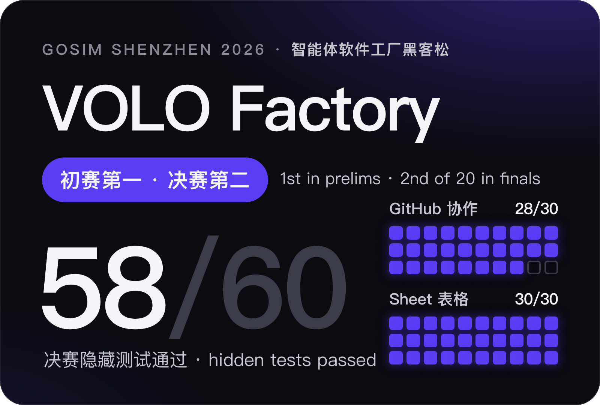
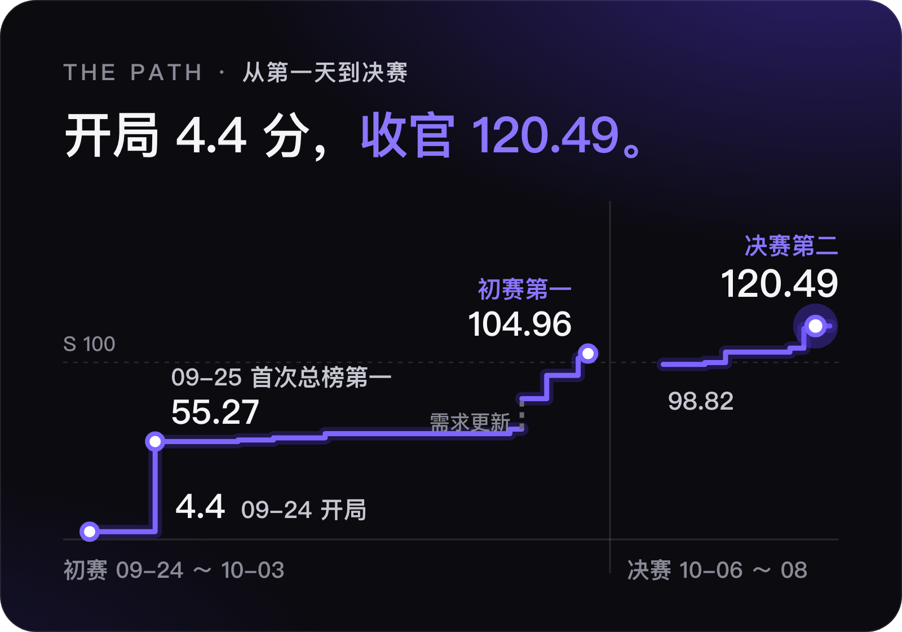
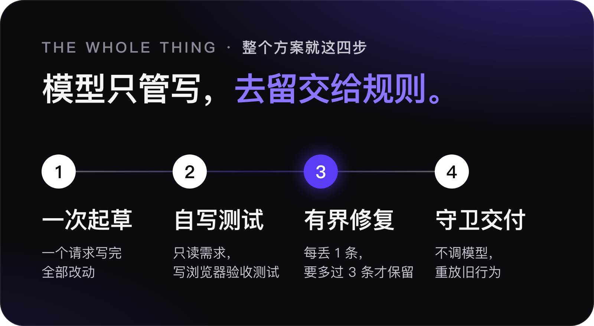
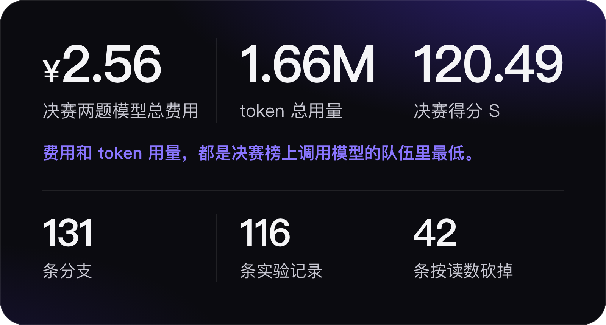

  

<h3 align="center">一份需求文档进去，一个能跑的 Web 应用出来。</h3>

展台海报是压缩版：四步、58/60、初赛第一和决赛第二。

这里是解压版：28 天里我们怎么从零走到这四步，试过什么、删掉什么、在哪里撞墙，每一步都留着记录。

  <a href="#从-0-到-1">从 0 到 1</a> ·
  <a href="#最后留下的四步">最后留下的四步</a> · <a href="TECH.md">技术记录 Tech log</a> ·
  <a href="#成绩">成绩</a> ·
  <a href="EXPERIMENTS.md">116 条实验</a> ·
  <a href="submission/finals/">决赛提交</a> ·
  <a href="#english">English</a>

https://github.com/user-attachments/assets/cf817a4f-abc1-4f5f-91c9-258fa920ea33

## 从 0 到 1

  

赛题只给一份需求文档：智能体从零写出 Web 应用，由看不见的 Playwright 测试打分，模型费用计入成绩；决赛是在自己初赛的应用上继续进化。下面按时间顺序写，每一章末尾是出处。

### 09-11 · 小题全过，大题过不去

最早的 VOLO Factory 是一个多轮工具循环：模型读文件、写文件、跑检查、再修。开赛前的练习小榜它拿过第一，Smoke 两题全过，一共花了 1.6 分钱。可一换成 Keep 这样的大题，一局要一百多次调用、八到十二块钱，最好也只有 25/32。

[09-11～09-14 账本](docs/archive/progress-2026-09-11-to-09-14.md) · [EXPERIMENTS.md](EXPERIMENTS.md) 09-15 行

### 09-15 · 第一次减法：只留一次起草

同一道 Keep：多轮循环跑了 186 次调用，22/32、12.03 元；一次调用加一张「方言卡」，27/32 和 29/32，每次不到 1 元。当天刚定下的 TypeScript 内核重写和 Prime Agent 适配一起停掉，入口只剩一次起草。

[蒸馏报告](docs/reports/2026-09-18-distillation.md) · `tag:archive/2026-09-16/ts-kernel`

### 09-18 凌晨 · 一夜 11 轮

队长 01:53 定下目标就去睡了。智能体自己循环：跑六道练习题，回放失败的用例，改一条规则或加一道确定性门禁，再跑。到 05:12 跑完 11 轮，练习总榜从 45.0% 到 60.8%。这一夜留下两条后来一直沿用的原则：能做成门禁的知识就不写进提示词；生成温度定为 0。

[目标模式账本](docs/reports/2026-09-18-goal-ledger.md) · [ADR 0001](docs/adr/0001-distillation-ladder.md) · [ADR 0002](docs/adr/0002-model-policy.md)

### 09-23 · 停下来，先写判据

连着跑了几天，读数开始原地打转：23 个独立样本没有一个满分，相邻两版差 5 到 8 分，落在噪声里。我们停掉单样本迭代，改成每个机制先写死判据再上场。修复的接受规则也从「只增不减」改成「每丢 1 条至少多过 3 条」：一次修好路由的修复让自检从 9 条涨到 28 条，却因为丢了两条被连拒三次。

[09-23 评审](docs/reports/2026-09-23-harness-review.md) · [初赛路线图 4.3](docs/reference/roadmap.md)

### 09-24 · 开赛，4.4 分

正式赛两道新题，各 100 条看不见的测试。第一个读数 GitHub 5/100、Sheet 3/100，S 4.4。一部分不怪我们：评测方缺种子数据，上午发的还是旧版赛题，当晚更正、截止顺延。一部分怪我们：脚手架的数据只活在单个浏览器会话里，改成服务器共享后 Sheet 从 3 到 42。

[`docs/progress.md`](docs/progress.md) 09-24 节

### 09-25 · 让它只读需求，自己写测试

用需求场景做自检，在正式题上几乎解析不了（Sheet 0/48、GitHub 0/64）。我们换了个思路：让同一个模型只看需求、不看应用，写浏览器验收测试，再用这些测试驱动修复；修复同时改成定点编辑。Sheet 从 43 到 53，再把守卫计作丢失后到 79，S 55.27，第一次登上总榜第一。这就是海报上的第二步。

[初赛路线图 4.2、4.11、4.15](docs/reference/roadmap.md) · PR #71、#73

### 09-26 ～ 10-01 · 平台期

接下来一周，分数在 55 到 60 之间横着走。几次「看起来能涨」的改动按判据撤回；真正推着走的是降本：写测试的十几次调用共享前缀、命中缓存，一次提交从 22 元降到 17 元，S 56.17。09-28 我们以为撞上了平台的额度墙，给主办方的问询都写好了，查下去是自己的代码把 API key 覆盖成了需求编号。同一天试了更激进的减法，连测试和修复也删掉，最高只有 40.5，撤回。减法到此为止。

[初赛路线图 4.21 ～ 4.24、4.33](docs/reference/roadmap.md)

### 10-02 ～ 10-03 · 冲到 104.96

换用更便宜的 vision-exp 模型，同一套做法 S 62.33；当天下午主办方更新了 GitHub 需求，S 跳到 79.48，这一跳不算我们的功劳。之后一天之内 92.66、102.28、104.96。组委会评审后公布的[入围名单](https://create.gosim.org/factory26/#qualified)上，VOLO-AI 排第一。

[10-02 读数](docs/evidence/2026-10-02-s70-achieved.json) · [选版报告](docs/reports/2026-10-03-final-candidate-selection.md)

### 10-06 · 决赛开局：先交了个零

决赛不从零写，而是在自己初赛的应用上继续进化。第一次在练习赛上跑，8 道题全部零分：平台运行时会往输出目录写日志，我们「冻结整个目录」的实现判定模板被改动。改成只回写变动的文件后，Web 六题 38/38。正式赛首个读数 24/60，GitHub 只有 3/30：需求写明登录在正文、搜索在页头，我们放错了地方。把需求写明的位置和提示角色写进方言卡、测试和守卫后，当晚 50/60。

[决赛路线图 F1、F2](docs/reference/finals-roadmap.md) · PR #121、#136

### 10-07 · 删掉只为过测试的规则

我们问自己：如果没有隐藏测试，一个认真的工程师只读需求，还会不会这么做？按这个标准审了 146 组规则，删改和评测耦合的两类。纯清理版本地分数掉了；加回四条（其中两条是灰区）后，官方 S 98.48，仍低于保底 98.82，撤回；再加上「同一个动作挪过去，不复制」，新提交 S 99.88，才超过保底。

[泛化审查](docs/reports/2026-10-07-generalization-audit.md)

### 10-08 · 58/60

第六版包 58/60，两题模型费用 2.56 元，S 120.49。18:47 我们是实时榜第一；19:50 另一支队伍交出了 60/60。最终二十支队伍里第二。

[v6 读数](docs/evidence/2026-10-08-v6-resume.json) · [决赛路线图 4.5 节](docs/reference/finals-roadmap.md) · [`submission/finals/`](submission/finals/)

### 10-17 · 深圳

组委会发来的决赛名单上，我们那一栏写着「我和我们的队友都想去 gosim 参加颁…（VOLO-AI）」。队名太长被截断了，但意思到了。10 月 17 日，GOSIM 深圳，颁奖。

 

## 最后留下的四步

把这 28 天压缩回来，就是海报上的四步。模型只写代码和测试，改动留不留、什么时候停，由代码按固定规则判定。

  

1. **一次起草**（来自 09-15）。需求、方言卡和旧源码放进同一个请求，温度 0，一次写完全部改动。
2. **自写测试**（来自 09-25）。同一个模型看不到应用，只读需求写 Playwright 验收测试。
3. **有界修复**（来自 09-23）。只许定点编辑；每丢 1 条至少多过 3 条才保留，否则换回；24 次调用或 10 元封顶。
4. **守卫交付**（来自 10-06）。不调模型：重放旧应用的行为，核对需求写明的位置；出任何异常都交付最后一个完整版本。

决赛前四名用的是同一个模型 `deepseek-v4-flash-vision-exp`，差距在 harness。

<b>十条机制，每条为什么这样做</b>

 

决赛包读需求，在平台注入的旧应用上做增量升级。改动留不留、什么时候停，由代码按固定规则判定；模型只写代码和写测试。代码以 [`submission/finals/package/source/`](submission/finals/package/source/) 为准（与 `main` 上的 `oneshot/` 相同，标签 `finals-submission`），行为说明见 [`docs/reference/oneshot.md`](docs/reference/oneshot.md)。正式提交指定的模型是网关上的 `deepseek-v4-flash-vision-exp`，回退模型 `kimi-k2.7-code-highspeed`。

1. **接收旧应用，只回写改动。** 输出目录非空就走升级路径：读有界源码快照（最多 256 个文件、2 MiB，超限报错不截断），不读 `.arc/` 与 `requirements/`，交付时只回写内容变了的文件。为什么：平台运行中持续往输出目录写日志，最初冻结整个目录的实现让练习赛第一轮 8 题全部零分，改后 6 题 38/38（[决赛路线图 F1](docs/reference/finals-roadmap.md)，PR #121）。
2. **一次调用起草。** 方言卡、交付契约、种子清单、需求原文、旧源码依次放进一个请求，末尾再附一段显示约定自查清单；温度 0；只输出改动或新增的完整文件，截断就续写。为什么：09-15 我们的多轮工具循环在 Keep 上 22/32、12.03 元，同日 one-shot 27/32、29/32，每次不到 1 元（`tag:archive/2026-09-16/ts-kernel` 的 `docs/progress.md`）；温度 0 让同包两样本从 60.8%/34.0% 收窄到 64.5%/58.6%（[ADR 0002](docs/adr/0002-model-policy.md)）。
3. **方言卡。** [`oneshot/dialect.md`](oneshot/dialect.md) 只写需求没写明时的默认做法（位置、角色、对话框、显示约定等）。为什么：同样的知识做成门禁或脚手架比写成散文管用，卡片是最后一级（[ADR 0001](docs/adr/0001-distillation-ladder.md)）；它三次清掉只对练习题或评测成立的规则（[初赛路线图 4.6](docs/reference/roadmap.md)、[10-03 审查](docs/reports/2026-10-03-unconditional-heuristics-audit.md)、[10-07 泛化审查](docs/reports/2026-10-07-generalization-audit.md)）。
4. **只看需求写验收测试。** 同一模型看不到应用，按顶层需求分组写 Playwright 测试，一组一个文件；测试自身出错记 error，不驱动修复。为什么：需求场景自检在正式题上几乎解析不了（Sheet 0/48、GitHub 0/64），书面测试接进修复环后 Sheet 从 43 升到 79（[4.2、4.11、4.15](docs/reference/roadmap.md)）；按组写让一套测试从 5.16 元降到 2.29 元，排序更准（4.32）。
5. **有界修复环。** 已有文件只许 SEARCH/REPLACE；失败按需求依赖深度排序；每丢 1 条至少多过 3 条才接受，否则换回；24 次调用、10 元、连续 4 次丢弃或 3 小时即停。为什么：「只增不减」会拒掉修好结构错误的修复，3:1 规则下 31 次修复公开分零下降（[4.3](docs/reference/roadmap.md)）；整份重发大文件每轮弄坏约 10 条，定点编辑让同一份初稿从 25 到 38（4.11）。
6. **旧行为守卫（不调模型）。** 起草前在隔离副本上以未登录状态遍历起点应用两遍、取交集作基线；之后每个版本按原路径重放，基线项丢了就交修复并否决该改动；需求写明的改名、删除豁免。为什么：代理题上新功能已近满分，稳定失分在旧行为；平台试跑中守卫找回 45、24、161 项旧界面，豁免收严反而只有 36/38（[守卫报告](docs/reports/2026-10-06-regression-guard.md)，PR #129）。
7. **需求位置核对（不调模型）。** 从需求抽出「控件在正文/页头/侧栏」这类明确句式，浏览器核对所在地标，缺的交修复，测试也按这些位置定位，提示要求「挪过去，不复制」。为什么：决赛首个正式读数 GitHub 3/30，27 条失败卡在正文「Sign in」和页头「Search」两个需求写明位置的入口，修正后 21/30（[F2-real](docs/reference/finals-roadmap.md)，PR #136、#139）。
8. **升级时跳过源码审查。** 为什么：初赛加入的代码反例审查在 13 次进化运行里零产出，关掉后代理两题通过数不变，费用从 1.31–1.67 元降到 0.78/0.64 元（PR #127）。
9. **永不交付空。** 任何异常后交付最后一个完整版本；网关在出字前拒绝不计失败、退避重试；回退模型只接管失败的那一次调用。为什么：截断与断流曾让整题零分，一次起草连败曾让整个运行切到贵约 6 倍的回退模型，28.02 元换来 5/100（[4.1、4.28、4.31](docs/reference/roadmap.md)）。
10. **同一提交循环重跑，按 S 定去留。** 为什么：b 只算被选中的运行，重跑不拉低 S，而同一个包的 GitHub 单样本在 15 到 21 之间波动（[决赛路线图 4.5 节](docs/reference/finals-roadmap.md)）。

## 成绩

  

**决赛** · 58/60 · ¥2.56 · S 120.49 · 二十支队伍里第二 
**初赛** · 166/200 · ¥6.35 · S 104.96 · 组委会入围名单第一

<b>成绩细节与出处</b>：正式提交号、被选中的运行、计分公式、重跑波动

 

每个数字都指向 `docs/` 或 `campaign/` 里的出处；run id、提交号和榜位都是记录时刻的读数。

| 阶段 | 正式提交与包 | 被选中的运行 | 合计 | 费用 | S | 名次 |
|---|---|---|---|---|---|---|
| 初赛 `hackathon`（2 题，各 100 条隐藏测试） | `12e3bab723fd`，v7 包 SHA-256 `4ae64326…` | GitHub `afc04ffe5b63` 79/100（1.636034 元）；Sheet `defb678bf0a1` 87/100（4.713723 元） | 166/200，p 83.0% | 6.349757 元 | 104.96 | 平台截止快照第 2；组委会入围名单第 1 |
| 决赛 `hackathon-evolution`（在初赛产物上继续进化，2 题共 60 条） | `218428c590f0`，包 `conv6-c2b48ef.zip`，SHA-256 `74247ff9ed35…` | GitHub `587401a01ed4` 28/30（1.407125 元）；Sheet `f3b82d5d29ba` 30/30（1.155562 元） | 58/60 | 2.562687 元 | 120.49 | 截止后 20:02 快照第 2；组委会 10-10 公布第 2 / 20 |

出处：初赛 [`campaign/evidence/2026-10-02-s70/board-cutoff-window.json`](campaign/evidence/2026-10-02-s70/board-cutoff-window.json)、[选版报告](docs/reports/2026-10-03-final-candidate-selection.md)；决赛 [`campaign/evidence/2026-10-06-finals/codex-resume-20261008/deadline-check-2002.json`](campaign/evidence/2026-10-06-finals/codex-resume-20261008/deadline-check-2002.json)、[`submission/finals/README.md`](submission/finals/README.md)。

- **计分。** 我们始终在奖励区，S = p / (b / 预期费用)^0.1，p 是两题合计通过率（百分数），b 是两题被选中运行的费用（元）；预期费用初赛是 0.8p、决赛是 0.24p（[`docs/reference/preliminary-rules.md`](docs/reference/preliminary-rules.md)，决赛按快照里的 `expected_cost` 核对）。
- **榜上是多次重跑里最好的一次。** 平台取每队最新一次有效提交、每题该提交内最好的运行，b 只算被选中的两次。决赛包在 GitHub 上 6 次完成的读数是 25、28、28、26、25、27，Sheet 7 次是 25、27、29、30、30、30、27，28/30 不是这个包的期望值。
- **初赛名次以组委会名单为准。** 平台截止快照上我们第 2；组委会评审后公布的[入围名单](https://create.gosim.org/factory26/#qualified)里 VOLO-AI 排第一，快照上唯一排在我们前面的队伍不在名单中。
- **名次随时间变。** 决赛截止前 18:47 我们是实时榜第 1（[`docs/evidence/2026-10-08-v6-resume.json`](docs/evidence/2026-10-08-v6-resume.json)）；19:50 起第 1 名是另一队一次 60/60、S 124.53 的提交。决赛榜上我们的队名显示为「这一次能赢吗？」，与初赛的 VOLO-AI 是同一个 team_id。
- **成绩曲线。** 初赛 S：09-24 基线 4.4，09-25 55.27（首次总榜第 1），09-28 59.75，10-02 79.48，10-03 104.96。决赛：首个正式读数 24/60，10-06 晚 50/60（S 98.82），10-08 57/60（S 119.06），最终 58/60。

<b>关键决策时间线</b>：每次决定当时的读数与链接

 

北京时间。依据是做决定时手上的读数；PR 编号指原开发仓库（见「仓库地图」末尾）。

| 日期 | 决策 | 依据 | 链接 |
|---|---|---|---|
| 09-15 | 放弃多轮工具循环 harness 和当天刚定的 TypeScript 内核重写，入口改成 one-shot | 多轮 harness Keep 22/32、12.03 元、撞预算；one-shot 27/32、29/32，每次 0.88–0.94 元；场景检查编译器在 Keep 上 32 条里 24 条判不了 | `tag:archive/2026-09-16/ts-kernel`；[蒸馏报告](docs/reports/2026-09-18-distillation.md)（文中称 multi-agent loop） |
| 09-15 | 关闭 Prime Agent 适配试验，不另起 agent 框架 | 裸跑 6/32，加方言卡 18/32，最好 22/32；它自建测试 37/37 就停手，官方挂 14 条 | 同上；[初赛路线图第 8 节](docs/reference/roadmap.md) |
| 09-17～09-18 | GLM 出局（10-02 复查仍出局） | 输出额度全花在推理上、零正文；glm-5.3 三次在 1201 秒被网关切断；10-02 两次 16,384 个输出 token 全是推理 | [ADR 0002](docs/adr/0002-model-policy.md)；[`docs/progress.md`](docs/progress.md) 10-02 03:01 节 |
| 09-18 | 知识下沉：能做成门禁就不写进卡片，随包发布脚手架 | 当天得分主要来自确定性门禁；脚手架轮 65.2%/58.7% 对上一轮 56.5%/63.0%；去掉题目形状规则约降 10 个百分点 | [ADR 0001](docs/adr/0001-distillation-ladder.md)；[目标模式账本](docs/reports/2026-09-18-goal-ledger.md)；`branch:exp/generic-card` |
| 09-18 | 生成温度定为 0 | 同包两样本 64.5%/58.6%，温度 0.3 时 60.8%/34.0% | [ADR 0002](docs/adr/0002-model-policy.md) |
| 09-18 → 09-25 | 双初稿择优：先否决；09-25 队长按推荐改为只在 GitHub 上做；当晚按写死的判据撤回 | GitHub 隐藏 16，判据 17，每次多约 17 分钟 | [4.17](docs/reference/roadmap.md)；PR #75、#77；`branch:feat/draft-pair` |
| 09-23 | 停掉「Lite 原生 Goal」和单样本迭代，改为判据写死的工作流 | 23 个独立样本 0 个满分；相邻版本差 5–8 分，在噪声内；候选唯一一次官方运行 9/34 | [09-23 评审](docs/reports/2026-09-23-harness-review.md)及附录 2；`branch:exp/lite-first-20260922` |
| 09-23 | 修复接受规则从「只增不减」改为「每丢 1 条至少多过 3 条」 | 一次修好路由的修复让自检 9 到 28，仍被连拒三次 | [4.3](docs/reference/roadmap.md)；PR #59 |
| 09-23 | 默认模型 flash，Kimi HighSpeed 只做回退 | 三组配对分不出高下，Kimi 每题贵 4–7 倍 | [4.5](docs/reference/roadmap.md)；`branch:exp/model-pair-20260923` |
| 09-24 → 09-25 | 场景自检在正式题上失效，改为按需求写测试驱动修复（开赛当天的方向评审把这条排在最后） | 打开后 Sheet 43、53；守卫改为计作丢失后 79，S 55.27 总榜第 1 | [4.2、4.11、4.15](docs/reference/roadmap.md)；PR #71、#73 |
| 09-26、09-27 | 4.21 从接力包撤回（队长定代码留 main）；4.23 关闭 | 4.21 首读 Sheet 69，判据 78；4.23 三次 82、56、78，均值低于判据 77，每次多花约 16 元 | [4.21、4.23](docs/reference/roadmap.md)；`branch:relay/without-4.21` |
| 09-27 | 把降本当提分杠杆：写测试的调用共享前缀命中缓存 | 同样的通过率，一次提交 22 元降到 17 元，S 56.17 | [4.24](docs/reference/roadmap.md)；PR #87 |
| 09-28 | 更正「401 墙」：是我们把 API key 覆盖成了需求编号，不是平台额度墙；作废主办方问询 | 另一次运行在约 3.3 元也撞墙；正确 key 重放返回 200 | [4.33](docs/reference/roadmap.md)；PR #98 |
| 09-28 | 撤回「只起草、多抽样」路线 | 24 个组合最高 S 40.5，不及当时的 57.4 | [初赛路线图「撤回：只起草」](docs/reference/roadmap.md) |
| 10-02 | 正式提交改用 vision-exp 模型，冲 S ≥ 70 | 首个完整对 S 62.33，增长来自费用；同一提交 GitHub 重跑 46、S 79.48，但同期主办方改了 GitHub 需求 | [`docs/evidence/2026-10-02-s70-achieved.json`](docs/evidence/2026-10-02-s70-achieved.json) |
| 10-03 | 分数优先于清理：清理版 v11 合 main，正式成绩保留 v7；v12 撤回 | v7 G79 + Sheet87、S 104.96；v12 两题耗尽失败上限 | [选版报告](docs/reports/2026-10-03-final-candidate-selection.md) |
| 10-06 | 决赛包：守卫宽松版默认开，严格版、定点编辑起草不用，Light 编译器默认关，升级跳过源码审查 | 宽松 38/38 对严格 36/38；定点编辑 33/38；编译器在代理题上 0/60 可编 | [决赛路线图 F1–F3](docs/reference/finals-roadmap.md)；PR #125、#127、#129 |
| 10-06 晚 | 需求写明的位置与提示角色进方言卡、测试和守卫 | 首个正式读数 3/30 + 21/30，候选 21/30 + 29/30 | [F2-real、F3](docs/reference/finals-roadmap.md)；PR #136 |
| 10-07 | 按「没有隐藏测试，认真的工程师只读需求还会不会这么做」清掉评测耦合规则，主会话收窄后加回四条（其中被拒操作用 alert、关闭按钮默认叫 Close 两条是灰区）；位置改为「挪不复制」 | 146 组：A 37、B 77、C 26、D 6；加回版 Sheet 25/27/24、GitHub 24/22，纯清理版 23/25/20、17/15；新提交 S 99.88 超过保底 98.82 | [泛化审查](docs/reports/2026-10-07-generalization-audit.md)；PR #139 |
| 10-08 | 人读官方报告归纳通用显示约定（主办方允许，报告不进智能体输入）；第六版定为最终包 | 第五版 57/60、S 119.06；第六版 58/60、S 120.49；第七版 S 110.25，删除 | [决赛路线图 4.5 节](docs/reference/finals-roadmap.md)；PR #147 |

每次实验的假设、判据、读数和去留在 [`EXPERIMENTS.md`](EXPERIMENTS.md)。

## 仓库里有什么

- [`oneshot/`](oneshot/)：最终的智能体，从 `main.py` 的 `generate()` 读起
- [`submission/finals/`](submission/finals/)：决赛提交原件，以及它生成的两份应用
- [`EXPERIMENTS.md`](EXPERIMENTS.md)：116 条实验的假设、判据、读数和去留，包括砍掉的 42 条
- [`docs/`](docs/README.md)：两份路线图、逐日账本、报告和 ADR
- [`campaign/`](campaign/)：比赛期间的文本证据，以及我们自己写的代理评测

<b>完整仓库地图、分支说明与阅读顺序</b>

 

| 路径 | 内容 |
|---|---|
| `oneshot/` | 最终 agent：`main.py`（起草、修复环）、`testgen.py`（写测试）、`regression_guard.py`（守卫与位置核对）、`dialect.md`（方言卡）、`scaffold/`（新建应用用的骨架，初赛产物由它起步） |
| `tests_oneshot/`、`scripts/package_oneshot.py` | 确定性单测；白名单、固定时间戳的打包，同源同哈希 |
| `submission/finals/` | 决赛提交原件、解压源码、两次最好运行生成的应用 |
| `docs/` | 先读 [`docs/README.md`](docs/README.md)：`reference/` 是活文档（[初赛路线图](docs/reference/roadmap.md)、[决赛路线图](docs/reference/finals-roadmap.md)）；`progress.md` 是 09-17 起的追加式账本；`reports/` 是冻结的日期报告；`adr/`；`evidence/`；`archive/` 是旧交接与 09-11～09-14 的账本 |
| `campaign/` | 比赛工作区的文本证据：`evidence/`（运行记录、榜单快照）、`acceptance-hidden/`（主会话专用暗题与仿隐藏意图评估器）、`finals-proxy/`（决赛代理题）、`finals-local/`（本地回放） |
| `main.py`、`volo/`、`harness_lab/`、`tests/`、`lab/`、`examples/` | 09-11～09-14 多轮 harness 时代的冻结代码与实验工具 |
| `qiwoo`、`tools/qiwoo_cli/`、`tests_forum/` | 独立的论坛读取 CLI，不进竞赛包 |

分支共 131 条：`feat/`（34）与 `fix/`（11）一个机制一条，经 PR 合入，没合入的是没过判据的候选（如 `feat/testgen-strict`、`feat/upgrade-patch-draft`）；`exp/`（14）是配对比较与探索，多数不合入；`docs/`（69）是每次会话的账本与交接；`goal/round-1` 是 09-18 目标模式 27 轮的代码线，`relay/without-4.21` 是撤回 4.21 后的接力包。标签 `archive/2026-09-16/*` 是收编前退役的工作树（`ts-kernel` 里有 09-15 的多轮 harness 与 Prime Agent 记录），`v0.6.0`、`v0.7.0-dev16`、`v0.7.0-dev31` 是练习赛版本，`finals-submission` 是决赛包源码。

从哪读起：本页与 [`EXPERIMENTS.md`](EXPERIMENTS.md)；[决赛路线图](docs/reference/finals-roadmap.md)与[初赛路线图](docs/reference/roadmap.md)（4.x、F1–F5 都是它们的工作流编号）；按日期读 [`docs/progress.md`](docs/progress.md)；代码从 `oneshot/main.py` 的 `generate()` 读起。

两点说明：公开前历史经过改写（统一作者信息、去掉敏感字符串），文档里的短提交号是改写前的值，改写前后对照在 [`docs/archive/commit-map.txt`](docs/archive/commit-map.txt)（每行「旧 新」），包与源码的对应以标签 `finals-submission` 为准；PR 编号保留在合并提交说明里，可用 `git log --grep='pull request #121 '` 查。文档里的「甲方」「用户」指队长。

<b>局限与诚实说明</b>：样本量、代理裁判的偏差、用过的官方信号、灰区规则

 

- **很多去留只靠一两个读数。** 同一个包的单样本波动很大（决赛包 GitHub 25–28，另一个包 GitHub 15–21，初赛一个包 Sheet 75–86），初赛路线图第 7 节估计单样本对单样本只能分辨 24–32 个百分点以上的差异。第六版替换第五版时，事先写的「本地两样本都 ≥ 27」没有完全满足；双初稿择优按一次读数撤回；按组写测试每臂一个样本。
- **本地数字来自代理裁判，不是官方。** 仿隐藏意图评估器（`campaign/acceptance-hidden/oracle-2026-09-27/`，GitHub Spearman 0.72，Sheet 比隐藏高约 17）、决赛代理题（`campaign/finals-proxy/`，第三版在 10 份官方产物上 292/300 逐条一致）和固定独立裁判都会偏乐观：同一份 GitHub 产物，独立裁判 69/66，官方 27/100（[10-02 瓶颈报告](docs/reports/2026-10-02-generalization-bottlenecks.md)）。受控修复的分数只说明机制。
- **我们用过的官方信号。** 初赛部分运行记录带失败测试名，只用于诊断；评估器是用 09-24 被撤回的旧题留下的隐藏测试标题写的，队长同意只在本地用；10-02～10-03 用过主办方公开自测的反馈；决赛运行下载包里的官方报告用于找原因、校准代理，10-08 起人读报告归纳通用显示约定，主办方答复允许并说明拿测试文件做拟合会判罚。两条灰区规则（被拒操作用 alert、对话框关闭默认叫 Close）来自官方报告里的失败，收窄后保留，并在审查报告里公开。包里没有题名、答案或任务专属分支。
- **外部变化混进了成绩。** 10-02 主办方更新 GitHub 需求（47 条里 40 条描述、46 个场景变化），同一提交 GitHub 从 18 到 46，S 59.61 到 79.48，这次跃升不能算到我们的机制上；09-24 赛题更正、09-25 Sheet 套件修复、10-08 两处断言放宽同理。
- **改动常打包上场。** 10-02 的候选同时换了 agent 和模型，多数版本一次带几处改动；只有 `EXPERIMENTS.md` 里标为消融的几组一次只改一处。
- **已知技术局限。** 生成代码没有 OS 级沙箱；守卫只看未登录界面；起草整份重写约 118 KB 的 `app.js` 会随机丢功能，这是决赛 GitHub 的主要上限；传输连续失败时单次调用会回退到 Kimi。名次以榜单快照和组委会公布为准。

## English

VOLO Factory is the agent harness our team built for ARC-Bench, the Agentic Software Factory Hackathon of GOSIM 2026. Given only a requirements document, the agent builds a working web application (in the finals, it extends its own preliminary app); hidden Playwright tests score the result and model cost enters the score. We ranked **1st on the organizers' qualified list for the preliminary round** (GitHub 79/100 + Sheet 87/100, S 104.96; 2nd on the platform's cutoff snapshot, the team ahead was not on the reviewed list) and **2nd of 20 in the finals**, passing 58 of 60 hidden tests for CNY 2.56 (S 120.49).

This README is the long version of our exhibition poster: the chapters above walk through the 28 days from a 4.4-point start to the final four-step agent, including what we tried and dropped. The final agent is deliberately small: one model call drafts the change, the same model writes browser acceptance tests from the requirements alone, and a bounded repair loop keeps or reverts every edit under fixed rules, guarded by two deterministic checks for existing behaviour and requirement-stated placement. Mechanisms were promoted only against criteria written down before the run, and many were withdrawn when they missed. This repository keeps that whole trail: the full git history with every experiment branch, dated roadmaps, ledger, reports and ADRs under `docs/`, curated evidence under `campaign/`, and the exact finals package with its two best generated apps under `submission/finals/`. Organizer materials are referenced but not included.

 

VOLO-AI · GOSIM Shenzhen 2026 · Agentic Software Factory Hackathon

