

  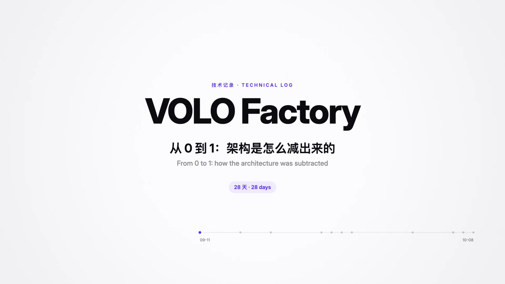

<h3 align="center">架构是怎么减出来的 · How the architecture was subtracted</h3>

左边是流水线的五个环节，每一章改动其中几格；右边是那一次决定的证据。 Left: the five pipeline stages, changed chapter by chapter. Right: the evidence behind each decision.

<a href="README.md">README</a> · <a href="#完整决策表--full-decision-log">完整决策表 Full log</a> · <a href="EXPERIMENTS.md">116 条实验 Experiments</a>

## 一览 · At a glance

| 日期 Date | 改动 Change | 结论 Verdict | 决定性读数 Deciding reading |
|---|---|---|---|
| [09-11](#09-11--起点--start) | 多轮工具循环 multi-round tool loop | 起点 start | Keep 186 次调用 calls · 22/32 · ¥12.03 |
| [09-15](#09-15--一次起草--one-call-draft) | 一次起草 + 方言卡 one call + dialect card | 采用 adopted | 27/32、29/32 · ¥0.88–0.94 |
| [09-18](#09-18--门禁与温度-0--gates-and-t--0) | 确定性门禁 · 温度 0 deterministic gates · T = 0 | 采用 adopted | 60.8/34.0 → 64.5/58.6 |
| [09-23](#09-23--先写判据--criterion-first) | 判据先行 · 3:1 修复 criterion first · 3:1 repair | 采用 adopted | 23 样本 samples · 0 满分 perfect |
| [09-24](#09-24--开赛--day-one) | 服务器共享状态 shared server state | 采用 adopted | Sheet 3 → 42 |
| [09-25](#09-25--只读需求写测试--tests-from-requirements) | 只读需求写测试 · 定点编辑修复 tests from requirements · patch repair | 采用 adopted | Sheet 43 → 53 → 79 · S 55.27 |
| [09-26～10-01](#09-2610-01--平台期--plateau) | 四个候选，按判据去留 four candidates, judged by criterion | 3 未采用 · 1 采用 3 dropped · 1 adopted | ¥22 → ¥17 |
| [10-02～10-03](#10-0210-03--冲刺--sprint) | vision-exp 模型 vision-exp model | 采用 adopted | S 104.96 |
| [10-06](#10-06--在旧应用上进化--evolve-the-shipped-app) | 只回写改动 · 升级时关掉源码审查 write back changes · review off | 采用 adopted | 8 题零分 → Web 38/38 |
| [10-06](#10-06--不调模型的守卫--a-guard-without-the-model) | 旧行为守卫（宽松） regression guard (lenient) | 采用 adopted | 38/38 vs 36/38 |
| [10-06 晚](#10-06-晚--需求写了位置就照着放--stated-placement) | 位置进方言卡、测试和守卫 placement into card, tests, guard | 采用 adopted | 24/60 → 50/60 |
| [10-07](#10-07--泛化审查--generalization-audit) | 删改迎合评测的规则，加回四条，挪不复制 coupled rules cut, four back, move not copy | 采用 adopted | 98.48 撤回 → 99.88 |
| [10-08](#10-08--第六版--version-six) | 显示约定清单 display checklist | 最终 final | 58/60 · S 120.49 |

## 09-11 · 起点 · Start

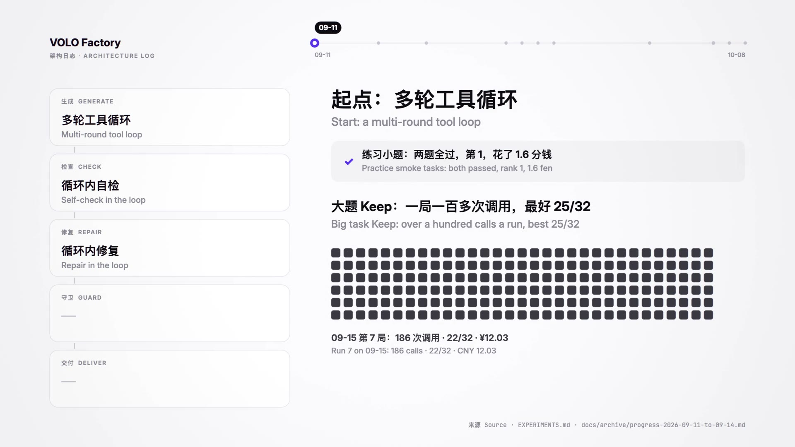

| 之前 Before | 之后 After | 依据 Evidence | 出处 Source |
|---|---|---|---|
| — | 多轮工具循环：分批生成，循环内自检、修复 multi-round tool loop, self-check and repair inside | 练习小题两题全过、第 1、1.6 分钱；大题 Keep 一局 186 次调用、22/32、¥12.03 smoke tasks passed, rank 1; Keep: 186 calls, 22/32, CNY 12.03 | [09-11～09-14 账本](docs/archive/progress-2026-09-11-to-09-14.md) · [EXPERIMENTS.md](EXPERIMENTS.md) |

## 09-15 · 一次起草 · One-call draft

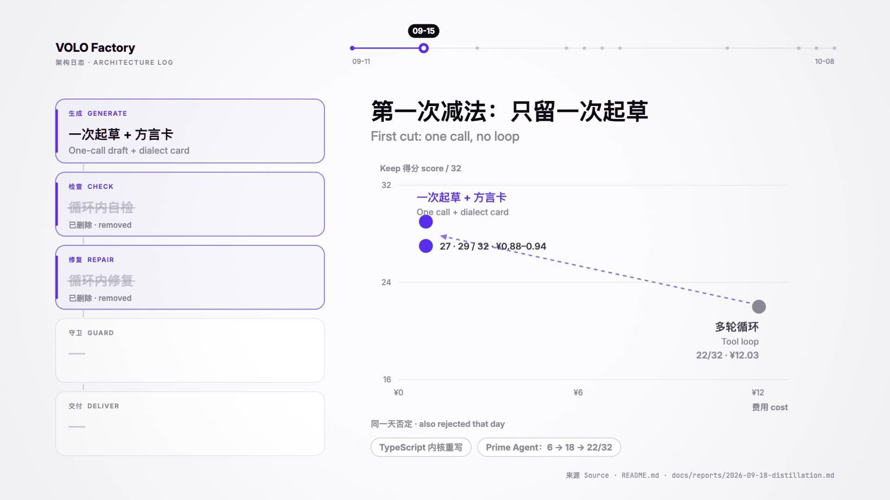

| 之前 Before | 之后 After | 依据 Evidence | 出处 Source |
|---|---|---|---|
| 多轮工具循环 tool loop | 一次调用 + 方言卡；无工具、无自检、无修复 one call + dialect card; no tools, no self-check, no repair | 22/32 · ¥12.03 → 27/32、29/32 · ¥0.88–0.94 | [蒸馏报告](docs/reports/2026-09-18-distillation.md) |
| TypeScript 内核重写 TS kernel rewrite | 否定 rejected | 场景检查编译器 32 条里 24 条判不了 scenario compiler could not judge 24 of 32 | `tag:archive/2026-09-16/ts-kernel` |
| Prime Agent 适配 Prime Agent adaptation | 否定 rejected | 6/32 → 18/32 → 22/32；自建测试 37/37 就停，官方挂 14 条 stops at its own 37/37; 14 official failures | [初赛路线图第 8 节](docs/reference/roadmap.md) |

## 09-18 · 门禁与温度 0 · Gates and T = 0

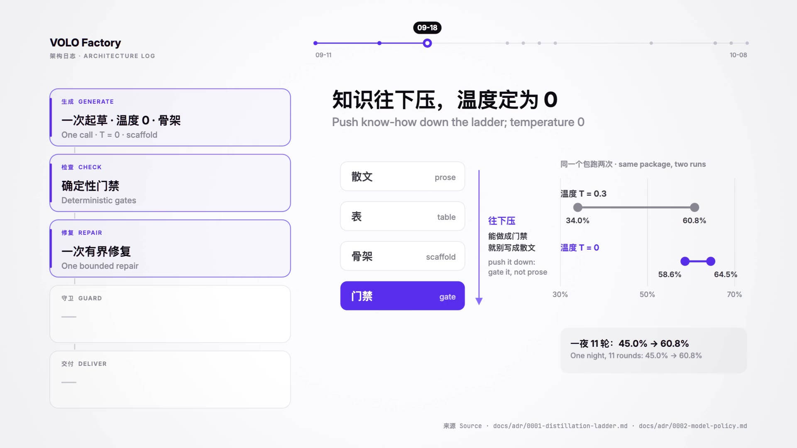

| 之前 Before | 之后 After | 依据 Evidence | 出处 Source |
|---|---|---|---|
| 规则写在提示词里 rules as prose | 能做成门禁就不写进卡片，随包发脚手架 gate it if you can; ship a scaffold | 一夜 11 轮：45.0% → 60.8% one night, 11 rounds | [ADR 0001](docs/adr/0001-distillation-ladder.md) · [目标模式账本](docs/reports/2026-09-18-goal-ledger.md) |
| 温度 0.3 T = 0.3 | 温度 0 T = 0 | 同包两样本 60.8% / 34.0% → 64.5% / 58.6% two samples of one package | [ADR 0002](docs/adr/0002-model-policy.md) |

## 09-23 · 先写判据 · Criterion first

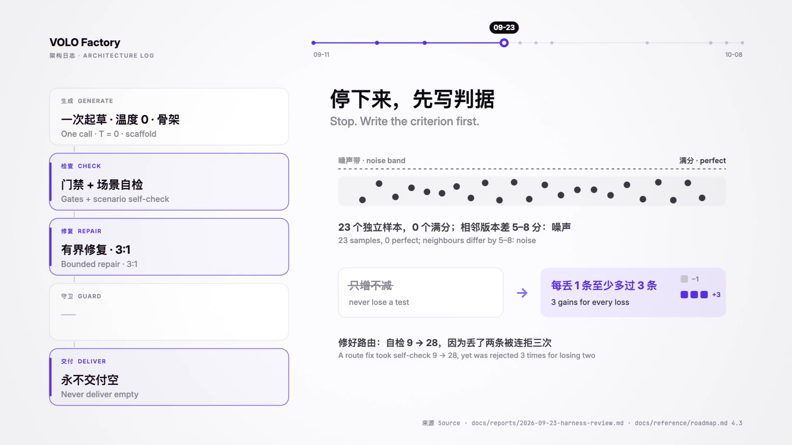

| 之前 Before | 之后 After | 依据 Evidence | 出处 Source |
|---|---|---|---|
| 单样本迭代 single-sample iteration | 每个机制先写死判据再上场 criterion written before each run | 23 个独立样本 0 个满分；相邻版本差 5–8 分，在噪声内 23 samples, 0 perfect; neighbours differ by 5–8 | [09-23 评审](docs/reports/2026-09-23-harness-review.md) |
| 修复「只增不减」 repair must never lose a test | 每丢 1 条至少多过 3 条 3 gains for every loss | 修好路由：自检 9 → 28，因为丢了两条被连拒三次 route fix 9 → 28, rejected 3 times for losing two | [初赛路线图 4.3](docs/reference/roadmap.md) |
| 截断或断流会交出空应用 a cut stream could ship nothing | 永不交付空：任何路径都交付最好的完整版本 never deliver empty | 截断与断流曾让整题零分 truncation and dropped streams once zeroed a whole task | [初赛路线图 4.1](docs/reference/roadmap.md) |

## 09-24 · 开赛 · Day one

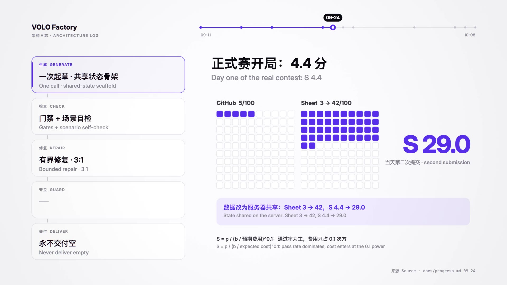

| 之前 Before | 之后 After | 依据 Evidence | 出处 Source |
|---|---|---|---|
| 脚手架数据只活在单个浏览器会话 state lived in one browser session | 服务器共享状态 state shared on the server | GitHub 5/100、Sheet 3/100（S 4.4）；Sheet 3 → 42 | [`docs/progress.md`](docs/progress.md) 09-24 |

## 09-25 · 只读需求写测试 · Tests from requirements

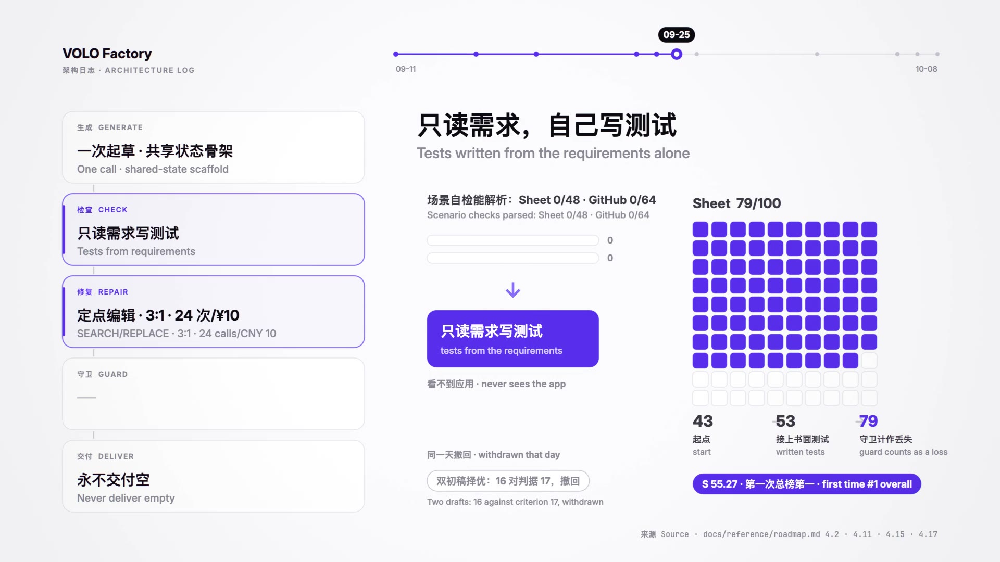

| 之前 Before | 之后 After | 依据 Evidence | 出处 Source |
|---|---|---|---|
| 需求场景自检 scenario self-check | 同一模型只看需求写 Playwright 测试，驱动修复 same model writes tests from requirements alone | 场景自检可解析 Sheet 0/48、GitHub 0/64；Sheet 43 → 53 | [初赛路线图 4.2、4.11](docs/reference/roadmap.md) |
| 整份重发、12 次 / 5 元 full resend, 12 calls / CNY 5 | 定点编辑 SEARCH/REPLACE、3:1、24 次 / 10 元；守卫计作丢失 patch edits, 3:1, 24 calls / CNY 10; guard counts as a loss | Sheet 53 → 79，S 55.27，首次总榜第一 | [初赛路线图 4.15](docs/reference/roadmap.md) |
| 双初稿择优 two drafts, keep the better | 撤回 withdrawn | GitHub 16，判据 17 | [4.17](docs/reference/roadmap.md) |

## 09-26～10-01 · 平台期 · Plateau

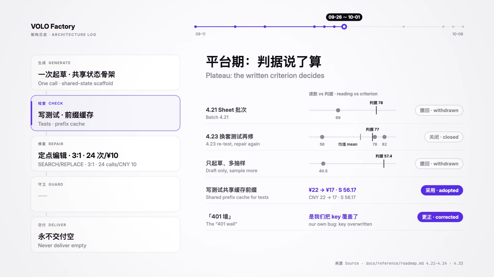

| 候选 Candidate | 读数 Reading | 判据 Criterion | 结论 Verdict | 出处 Source |
|---|---|---|---|---|
| 4.21 Sheet 批次 batch 4.21 | Sheet 69 | 78 | 撤回 withdrawn | [4.21](docs/reference/roadmap.md) |
| 4.23 换套测试再修 re-test after repair stops | 82 · 56 · 78 | 均值 mean ≥ 77 | 关闭 closed | [4.23](docs/reference/roadmap.md) |
| 只起草、多抽样 draft only, sample more | S 40.5 | 当时 then 57.4 | 撤回 withdrawn | [初赛路线图](docs/reference/roadmap.md) |
| 写测试共享缓存前缀 shared prefix cache for tests | ¥22 → ¥17，S 56.17 | 同样的通过率 same pass rate | 采用 adopted | [4.24](docs/reference/roadmap.md) |
| 「401 墙」 the "401 wall" | 是我们把 key 覆盖成了需求编号 our own bug: key overwritten | — | 更正 corrected | [4.33](docs/reference/roadmap.md) |

## 10-02～10-03 · 冲刺 · Sprint

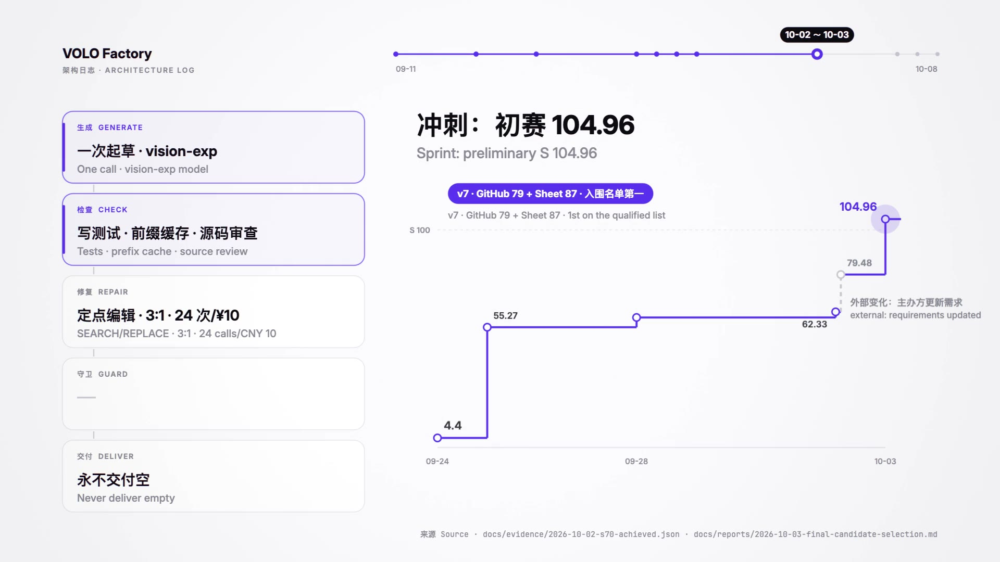

| 之前 Before | 之后 After | 依据 Evidence | 出处 Source |
|---|---|---|---|
| deepseek-v4-flash | vision-exp 模型；检查里加入源码审查 vision-exp model; a source review joins the checks | S 62.33；GitHub 重跑 79.48 时主办方同期更新了需求（灰色虚线，不算机制收益）；v7 G79 + Sheet87，S 104.96 | [10-02 读数](docs/evidence/2026-10-02-s70-achieved.json) · [选版报告](docs/reports/2026-10-03-final-candidate-selection.md) |

## 10-06 · 在旧应用上进化 · Evolve the shipped app

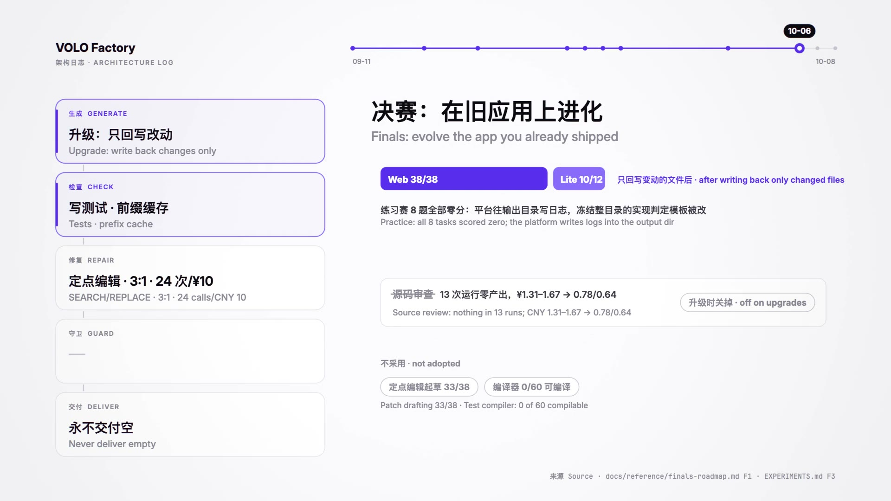

| 之前 Before | 之后 After | 依据 Evidence | 出处 Source |
|---|---|---|---|
| 冻结整个输出目录 freeze the whole output directory | 只回写内容变了的文件 write back changed files only | 练习赛 8 题全部零分 → Web 6 题 38/38、Lite 2 题 10/12 8 tasks at zero → Web 38/38, Lite 10/12 | [决赛路线图 F1](docs/reference/finals-roadmap.md) |
| 源码审查 source review | 升级时关掉 off for upgrades | 13 次进化运行零产出；¥1.31–1.67 → 0.78/0.64 | [EXPERIMENTS.md](EXPERIMENTS.md) F3 |
| 定点编辑起草 · 测试编译器 patch drafting · test compiler | 不采用 not adopted | 33/38；代理题 0/60 可编译 33/38; 0 of 60 compilable | [决赛路线图 F1–F3](docs/reference/finals-roadmap.md) |

## 10-06 · 不调模型的守卫 · A guard without the model

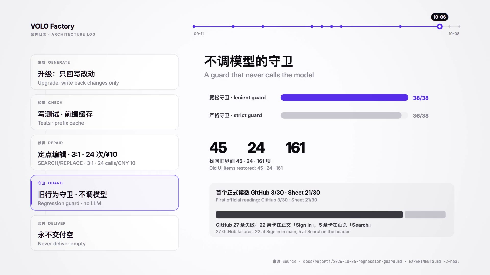

| 之前 Before | 之后 After | 依据 Evidence | 出处 Source |
|---|---|---|---|
| — | 旧行为守卫（宽松，不调模型） regression guard, lenient, no LLM | 宽松 38/38 对严格 36/38；找回旧界面 45、24、161 项 | [守卫报告](docs/reports/2026-10-06-regression-guard.md) |
| 首个正式读数 first official reading | GitHub 3/30 · Sheet 21/30 | GitHub 27 条失败：22 条卡在正文「Sign in」，5 条卡在页头「Search」 | [EXPERIMENTS.md](EXPERIMENTS.md) F2-real |

## 10-06 晚 · 需求写了位置，就照着放 · Stated placement

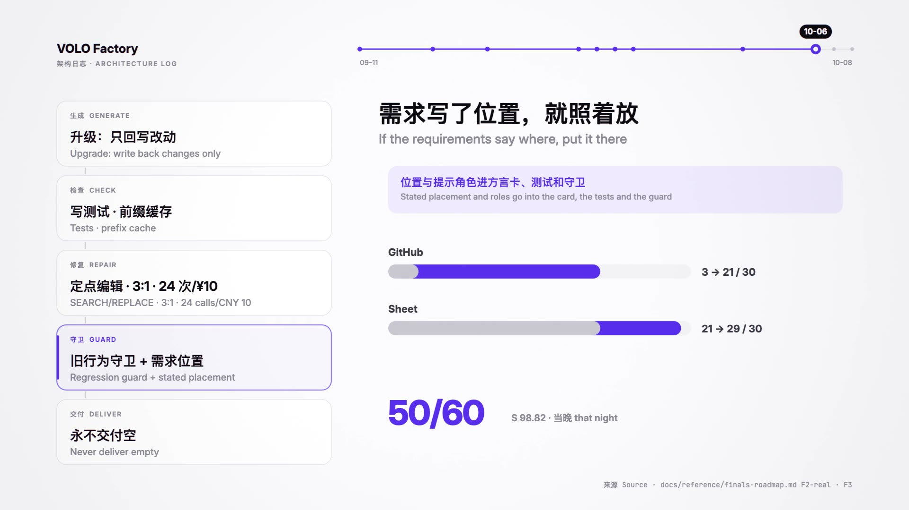

| 之前 Before | 之后 After | 依据 Evidence | 出处 Source |
|---|---|---|---|
| 位置由模型自由发挥 placement left to the model | 需求写明的位置与提示角色进方言卡、测试和守卫 stated placement and roles into card, tests, guard | 3/30 + 21/30 → 21/30 + 29/30，50/60，S 98.82 | [F2-real、F3](docs/reference/finals-roadmap.md) |

## 10-07 · 泛化审查 · Generalization audit

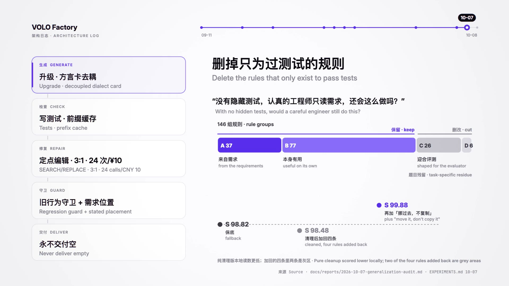

| 类别 Class | 含义 Meaning | 数量 Count | 去留 Fate |
|---|---|---|---|
| A | 来自本次需求 from the requirements | 37 | 保留 keep |
| B | 没有评测也有用 useful on its own | 77 | 保留 keep |
| C | 迎合评测或定位器 shaped for the evaluator | 26 | 删改 cut |
| D | 题目残留 task-specific residue | 6 | 删改 cut |

| 版本 Version | 读数 Reading | 结论 Verdict |
|---|---|---|
| 纯清理 pure cleanup | 本地 Sheet 23/25/20、GitHub 17/15 | 低于对照 below control |
| 加回四条（两条灰区） four rules back, two grey | 官方 S 98.48 < 保底 98.82 | 撤回 withdrawn |
| 再加「挪过去，不复制」 plus "move it, don't copy it" | 49/60，S 99.88 | 保留 kept |

出处：[泛化审查](docs/reports/2026-10-07-generalization-audit.md) · [EXPERIMENTS.md](EXPERIMENTS.md) 10-07

## 10-08 · 第六版 · Version six

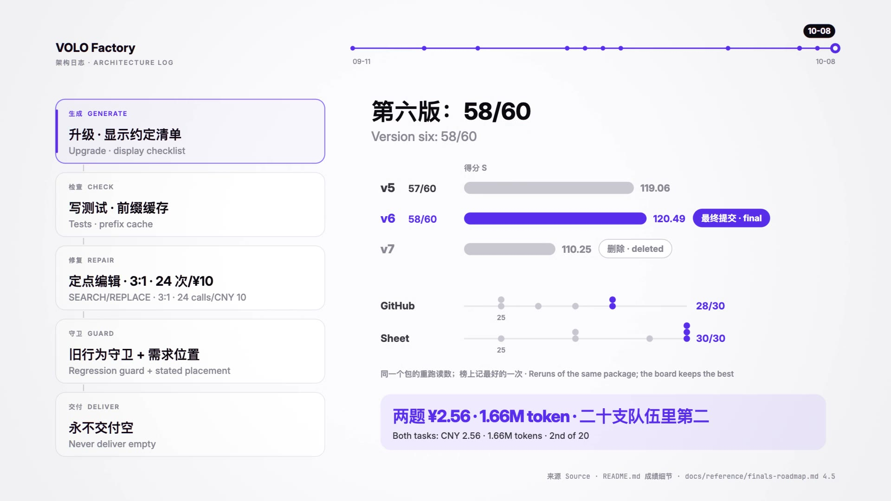

| 版本 Version | 决赛 Finals | S | 结论 Verdict |
|---|---|---|---|
| v5 | 57/60 | 119.06 | — |
| **v6** | **58/60** | **120.49** | **最终提交 final** |
| v7 | — | 110.25 | 删除 deleted |

| 第六版重跑 v6 reruns | 读数 Readings | 榜上 On the board |
|---|---|---|
| GitHub（6 次） | 25、28、28、26、25、27 | 28/30 |
| Sheet（7 次） | 25、27、29、30、30、30、27 | 30/30 |

榜上取同一提交里最好的一次，58/60 不是这个包的期望值。两题模型费用 ¥2.56，1.66M token，二十支队伍里第二。The board keeps the best run; 58/60 is not the package's expected score. Both tasks: CNY 2.56, 1.66M tokens, 2nd of 20. 出处：[README 成绩细节](README.md#成绩) · [决赛路线图 4.5 节](docs/reference/finals-roadmap.md)

## 最后留下的四步 · What was left

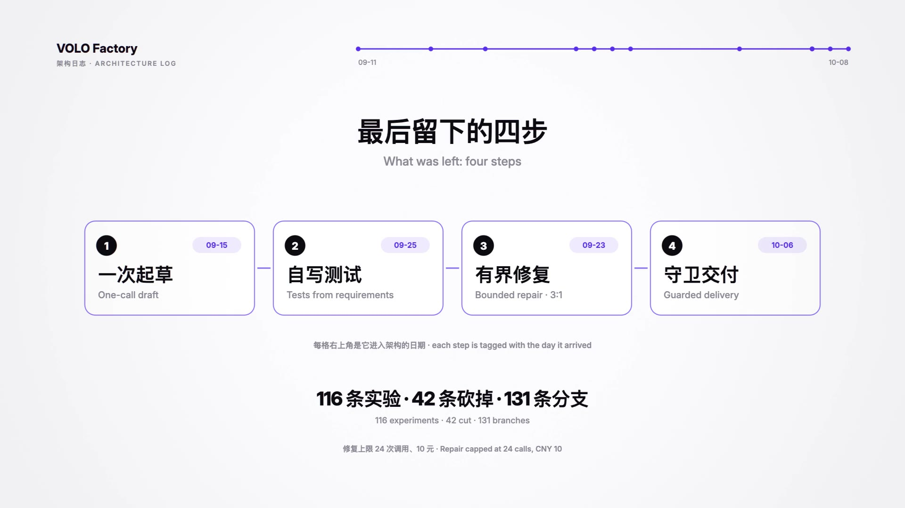

| 步骤 Step | 进入架构 Arrived | 做什么 What it does |
|---|---|---|
| 一次起草 one-call draft | 09-15 | 需求、方言卡、旧源码放进同一个请求，温度 0 requirements, dialect card and old source in one request, T = 0 |
| 自写测试 tests from requirements | 09-25 | 同一模型看不到应用，只读需求写 Playwright 测试 the model never sees the app |
| 有界修复 bounded repair | 09-23 | 定点编辑，每丢 1 条至少多过 3 条，24 次调用或 10 元封顶 SEARCH/REPLACE edits, 3:1 rule, capped at 24 calls or CNY 10 |
| 守卫交付 guarded delivery | 10-06 | 不调模型：重放旧行为、核对需求写明的位置，永不交付空 no LLM: replay old behaviour, check stated placement, never ship empty |

## 完整决策表 · Full decision log

| 日期 Date | 决策 Decision | 依据 Evidence | 出处 Source |
|---|---|---|---|
| 09-15 | 放弃多轮工具循环和 TypeScript 内核重写，入口改成一次起草 drop the tool loop and the TS kernel rewrite; one call | Keep 22/32 · ¥12.03 对 27/32、29/32 · ¥0.88–0.94 | [蒸馏报告](docs/reports/2026-09-18-distillation.md) |
| 09-15 | 关闭 Prime Agent 适配，不另起框架 close the Prime Agent adaptation | 6/32、18/32、最好 22/32 | [初赛路线图第 8 节](docs/reference/roadmap.md) |
| 09-17～09-18 | GLM 出局 GLM out | 输出额度全花在推理上、零正文；三次在 1201 秒被切 all output tokens spent on reasoning; cut at 1201 s three times | [ADR 0002](docs/adr/0002-model-policy.md) |
| 09-18 | 知识下沉：能做门禁就不写进卡片，随包发骨架 gates over prose; ship a scaffold | 骨架轮 65.2% / 58.7% 对上一轮 56.5% / 63.0% | [ADR 0001](docs/adr/0001-distillation-ladder.md) |
| 09-18 | 温度 0 temperature 0 | 64.5% / 58.6% 对 0.3 时 60.8% / 34.0% | [ADR 0002](docs/adr/0002-model-policy.md) |
| 09-18 → 09-25 | 双初稿择优：先否决、后试、按判据撤回 two drafts: rejected, tried, withdrawn | GitHub 16，判据 17 | [4.17](docs/reference/roadmap.md) |
| 09-23 | 停掉单样本迭代，判据写死 stop single-sample iteration | 23 个样本 0 个满分；相邻版本差 5–8 分 | [09-23 评审](docs/reports/2026-09-23-harness-review.md) |
| 09-23 | 修复接受规则改为 3:1 repair acceptance becomes 3:1 | 自检 9 → 28 仍被连拒三次 | [4.3](docs/reference/roadmap.md) |
| 09-23 | 默认 flash，Kimi 只做回退 flash by default, Kimi as fallback | 三组配对分不出高下，Kimi 贵 4–7 倍 three pairs indistinguishable; Kimi 4–7× the cost | [4.5](docs/reference/roadmap.md) |
| 09-24 → 09-25 | 改为按需求写测试驱动修复 tests from requirements drive repair | Sheet 43、53，守卫计作丢失后 79，S 55.27 | [4.2、4.11、4.15](docs/reference/roadmap.md) |
| 09-26、09-27 | 4.21 撤回，4.23 关闭 4.21 withdrawn, 4.23 closed | 69 对判据 78；82、56、78 均值低于 77 | [4.21、4.23](docs/reference/roadmap.md) |
| 09-27 | 写测试共享缓存前缀 shared prefix cache | ¥22 → ¥17，S 56.17 | [4.24](docs/reference/roadmap.md) |
| 09-28 | 更正「401 墙」：是我们的 bug the "401 wall" was our bug | 正确 key 重放返回 200 replay with the right key returns 200 | [4.33](docs/reference/roadmap.md) |
| 09-28 | 撤回「只起草、多抽样」 withdraw draft-only sampling | 24 个组合最高 S 40.5，不及 57.4 | [初赛路线图](docs/reference/roadmap.md) |
| 10-02 | 改用 vision-exp 模型 switch to vision-exp | S 62.33；79.48 那一跳混入了需求更新 | [10-02 读数](docs/evidence/2026-10-02-s70-achieved.json) |
| 10-03 | 分数优先：正式成绩保留 v7，v12 撤回 keep v7 as the score; withdraw v12 | v7 G79 + Sheet87，S 104.96 | [选版报告](docs/reports/2026-10-03-final-candidate-selection.md) |
| 10-06 | 宽松守卫默认开；严格守卫、定点编辑起草、编译器不用；升级跳过源码审查 lenient guard on; strict guard, patch draft, compiler off; skip review on upgrades | 38/38 对 36/38；33/38；0/60 | [决赛路线图 F1–F3](docs/reference/finals-roadmap.md) |
| 10-06 晚 | 需求写明的位置进方言卡、测试和守卫 stated placement enters card, tests and guard | 3/30 + 21/30 → 21/30 + 29/30 | [F2-real、F3](docs/reference/finals-roadmap.md) |
| 10-07 | 删改评测耦合规则，加回四条（两条灰区），位置改为挪不复制 cut coupled rules, add four back, move don't copy | 146 组：A 37、B 77、C 26、D 6；加回版 S 98.48 撤回；挪不复制后 S 99.88 | [泛化审查](docs/reports/2026-10-07-generalization-audit.md) |
| 10-08 | 第六版定为最终包 version six is final | v5 57/60 · S 119.06；v6 58/60 · S 120.49；v7 S 110.25 删除 | [决赛路线图 4.5 节](docs/reference/finals-roadmap.md) |

每一次实验的假设、判据、读数和去留在 [`EXPERIMENTS.md`](EXPERIMENTS.md)，共 116 条，其中 42 条按读数砍掉。All 116 experiments with hypothesis, criterion, reading and fate; 42 were cut.
