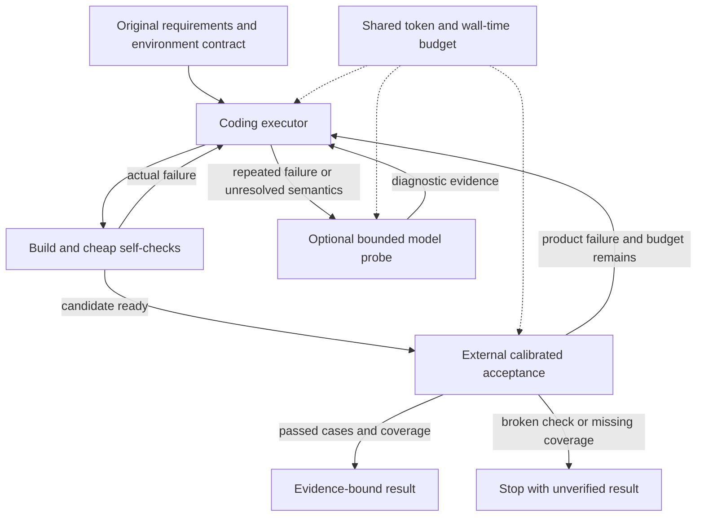

# Harness design review: independent evidence without a second full agent

Reviewed: 2026-09-12. This is a proposal grounded in source inspection and our own
recorded failures. It does not claim new official scores or comparative model results.

## Decision

Keep one small coding executor, one external evidence path, and a bounded controller.
The executor may run cheap self-checks and repair from failures. It does not certify
that requirements are satisfied. Independent acceptance does not require a second LLM:
run calibrated executable checks first; use a model only when it adds information that
those checks cannot provide, with an explicit budget and trigger.

The present integration preserves the experiments needed to test that proposal. It
does not turn them all on, introduce an orchestrator agent, or choose Pi/Octos as the
production worker before measuring them under the same conditions.

## What the inspected sources establish

| Source at inspected revision | Observed mechanism | Relevance and limit |
|---|---|---|
| [Octoscode architecture](https://github.com/octos-org/octoscode/blob/12feed7b50162450a216255d63ea2068f79c7756/docs/ARCHITECTURE.md) | Terminal client consumes a server-owned protocol; runtime, tools and approvals belong to Octos | Inspect the server for execution behavior; terminal UI complexity is not needed for a competition worker |
| [Octos verifier](https://github.com/octos-org/octos/blob/f4e44b192e39fc634ca0c9e0ae2e31704ccf1d73/crates/octos-agent/src/agent/verifier.rs) | Opt-in separate provider, failure/repetition triggers, recent five ledger entries, 512 maximum output tokens, actual verifier usage charged | Borrow bounded, event-triggered diagnosis. Its ledger-based readiness judgment is not an independent GUI or requirements test |
| [Octos ARC adapter](https://github.com/octos-org/arc-adapter/blob/b0999c95f7875c8d4ff3e58e733fb2c5abc8caf7/main.py) | Separates platform runtime events, Octos driver, requirements and build/start rehearsal | Useful source for the integration boundary. It also contains benchmark-specific UI/default-value instructions; these are not universal product rules |
| [Pi agent loop](https://github.com/earendil-works/pi/blob/71dca871bc80b6bc97be37f0ca3189399d651fff/packages/agent/src/agent-loop.ts) | Tool loop, event stream and context conversion are separate; length-truncated tool calls are failed without execution | Borrow a small replaceable executor and valid tool/result history. The installed local Pi 0.83.0 is a different version from this inspected HEAD |
| [mini-SWE-agent](https://github.com/SWE-agent/mini-swe-agent/blob/04d809ceab9df28f9adaed044884180159172930/src/minisweagent/agents/default.py) | Model/environment separation; step, cost, wall-time and consecutive-format-error limits; trajectory saved on every step | Borrow explicit stop reasons and a simple control loop. Its cost check happens between calls; an in-flight response can exceed a threshold |
| [OpenHands critic interface](https://github.com/OpenHands/software-agent-sdk/blob/9c3571a694547734002518bd94b3cb41a187f9b6/openhands-sdk/openhands/sdk/critic/base.py) | Default critique on finish/message, optional all-action mode, bounded refinement | Borrow sparse invocation. A [built-in completion critic](https://github.com/OpenHands/software-agent-sdk/blob/9c3571a694547734002518bd94b3cb41a187f9b6/openhands-sdk/openhands/sdk/critic/impl/agent_finished.py) checks a finish action and nonempty patch, not application correctness |
| [Harbor trial](https://github.com/harbor-framework/harbor/blob/d6ea0ae1fd19b4c66598d0bc1a992a9d8b9dc53d/src/harbor/trial/trial.py), [verifier](https://github.com/harbor-framework/harbor/blob/d6ea0ae1fd19b4c66598d0bc1a992a9d8b9dc53d/src/harbor/verifier/verifier.py) | Agent execution and verifier execution have separate results, environments and timeouts; absent/malformed rewards are errors | Borrow a worker-independent experiment contract, without adopting the entire benchmark platform |

The Octos [adapter README](https://github.com/octos-org/arc-adapter/blob/b0999c95f7875c8d4ff3e58e733fb2c5abc8caf7/README.md)
identifies itself as an ARC reference implementation and links the tutorial and runner
repository. That is direct technical relevance. This review did not independently
establish an individual's organizer role or verify that this source produced a
particular leaderboard entry.

An older [Octos context-efficiency review](https://github.com/octos-org/octos/blob/f4e44b192e39fc634ca0c9e0ae2e31704ccf1d73/docs/harness-context-efficiency.md)
usefully separates fixed tool-schema overhead, returned tool output and compaction.
Its July token estimates and performance comparisons are dated claims, not current
measurements of our gateway. Measure our own request sizes before adding another layer.

## Proposed flow

- **Executor:** one active implementation loop, small file/edit/command tools and a
  durable trace. VOLO, Pi or Octos may implement this role. Self-checks are allowed:
  removing fast feedback would push avoidable errors into slower external iterations.
- **Acceptance:** a versioned suite outside writable product code, attached to original
  requirements. Fixed scripts cost execution time but no model tokens. Model-generated
  checks remain hypotheses until positive/negative calibration; they must not silently
  become authoritative merely because another agent authored them.
- **Controller:** classifies failures, reserves time for final verification, and stops
  repeated no-progress attempts. It passes compact observed failures to the executor,
  not another copy of the full conversation. It cannot use an LLM's confidence as a score.
- **Model probe:** optional. Trigger at candidate completion when meaningful requirements
  are still untested, or after a repeated failure that deterministic diagnostics cannot
  distinguish. The current bounded browser experiment provides a starting point. Avoid
  running it after every edit or creating a second long-running coding conversation.

The executable suite is regenerated or reviewed when requirements change, not on every
product edit. Assertions are rerun against the changed product. Reusing a verdict needs
matching requirements, source and check versions; reusing test code does not mean
reusing a stale pass. Browser state and backend test data also need explicit reset rules.

## What still needs evidence

1. **Calibrate one GUI acceptance path with retained artifacts.** Use known failures
   such as duplicate exact username text, missing labels and logout timing, alongside
   the unchanged E047 app and diagnostic controls. Verify which defects are product
   failures and which are evaluator limitations. Tests remain unchanged during each
   comparison. A suite which passes every candidate has not established its usefulness.
2. **Measure the independent model probe separately.** Record defects correctly found,
   false alarms, unchecked requirements, extra tokens and time. Only keep it in the
   default flow if the result improves under a matched overall budget. Current synthetic
   probes establish plumbing only.
3. **Compare one alternative executor.** Reuse the same requirements, images, environment,
   checks and gateway/model budget. Pi has a local protocol adapter; Octos has an ARC
   adapter upstream. Choose one comparison, pin its binary and adapter versions, and
   report official results separately. Do not vary executor, model, prompt rules and
   budget simultaneously.
4. **Transfer after the first calibrated result.** Freeze the candidate before an unseen
   requirement variation. In particular, assess the inherited primary-link uniqueness
   heuristic: valid products can contain several navigation links to the same page.
   A test-specific workaround does not become general merely by omitting the task name.

The next development branch should first calibrate acceptance on existing artifacts.
That provides a useful decision without another paid generation run. A real model or
platform experiment follows a concrete hypothesis and agreed resource scope. No such
experiment was started by this review or by merging the workspace.
